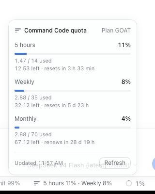

# dsh-provider-commandcode

Command Code ([commandcode.ai](https://commandcode.ai)) provider plugin for **DeepSeek Harness** (`dsh`).

One route (`commandcode`), both Provider API wires: **Claude on the Anthropic Messages wire**, **every other model on Chat Completions**. Live model discovery filtered by your actual plan, the Command Code CLI's own sign-in reused with zero configuration, a **quota status bar in the composer**, effort-aware reasoning, tool calls, images, cached-token accounting, and `/commandcode` diagnostics.



Unofficial community plugin. Not affiliated with or endorsed by Command Code or DeepSeek.

## Requirements

- `dsh` 0.2.x (`engines.dsh: >=0.2.0 <0.3.0`).
- A Command Code account with **Provider API** entitlement (Pro, GOAT, Max, Ultra, Team, Provider). The **Go** plan has no Provider API: requests fail with `403 upgrade_required`.

## Install

```sh
# From npm (once published)
dsh plugin --profile web add dsh-provider-commandcode

# From this checkout
dsh plugin --profile web add /path/to/dsh-provider-commandcode

# From git (pnpm asks you to allow the package's build script first)
dsh plugin --profile web add github:abcdlsj/dsh-provider-commandcode
```

Then boot: `dsh web` (or `dsh tui`, `dsh headless "task"`). The row is `llm-commandcode`; the profile's `cordis.patch.yml` can override its `config`.

## Authentication

The key is resolved per request, first match wins:

1. **Credentials service** value for `apiKeyEnv` (default `COMMANDCODE_API_KEY`) — what the web Models page writes.
2. `$COMMANDCODE_API_KEY` (or the configured `apiKeyEnv` name) in the launch environment.
3. `$COMMAND_CODE_API_KEY`.
4. Auth files, first usable one: `authFile` from config, `$COMMANDCODE_AUTH_FILE`, `~/.commandcode/auth.json` (the `command-code` CLI's own sign-in), `$PI_CODING_AGENT_DIR/auth.json` or `~/.pi/agent/auth.json`, `~/.omp/agent/auth.json`.

So if you already use the `command-code` CLI, there is nothing to configure: the plugin reuses that key. Headless profiles disable the credentials service, which is exactly why the CLI sign-in fallback exists.

An unusable value (blank, or characters no HTTP header can carry) fails as `INVALID_CREDENTIAL` naming the setting to fix, never echoing the key.

**Cross-source fallback.** When the provider answers `401` for the key this process chose, the plugin retires that key and tries the next source (`keyFallback: false` disables it). That is what makes a stale `command-code` CLI sign-in yield to a still-valid `~/.pi/agent/auth.json` credential instead of failing the prompt. It retries at most five distinct keys, never the same one twice, and logs one warning naming the two sources.

## Select a model

Pick `Command Code` in the model picker, or pin it in a profile overlay:

```yaml
# web/tui profile overlay (or the profile's cordis.patch.yml)
- id: agent-default-model
  config:
    provider: commandcode
    model: claude-opus-5
```

Every model your plan includes is served. Claude ids go to `/messages`; everything else goes to `/chat/completions` (including models that also advertise `/responses`). Tool calls, streaming reasoning, images, usage (including cached and reasoning tokens), stop sequences, and `max_tokens` all map onto the wire.

### Plan-aware catalog

The plugin reads your subscription (`/alpha/billing/subscriptions`) and the official CLI catalog's `Min plan` column, then lists only the models your tier can call:

| `plan` | Effect |
| --- | --- |
| `auto` (default) | Read the account plan. Bought or granted credits make every model reachable. |
| `go` / `goat` / `pro` / `max` | Pin a tier, without reading the account. |
| `all` | List everything and let Command Code refuse what it refuses. |

A model above the tier is refused **before any request**, with a message naming both the required and the current plan. If the account cannot be read, the plugin fails open: every model stays listed with a warning in `/commandcode status` — never an empty picker.

### Quota status bar

While the session's selected model belongs to `commandcode`, the composer dock shows a quota pill: `5 hours 11% · Weekly 8%`. Clicking it opens the plan, each rolling window with its used/limit and reset countdown, the month's credits, and a manual refresh. It polls once a minute and on page visibility, and hides itself for every other provider. The browser never holds the API key: the host reads `/alpha/billing/credits` and answers the client's `commandcode/usage` call.

## Configuration

All fields are optional. Defaults work with no configuration.

| Field | Default | Meaning |
| --- | --- | --- |
| `apiKeyEnv` | `COMMANDCODE_API_KEY` | Credential reference, also the environment variable name. |
| `keyFallback` | `true` | On a `401`, retire the refused key and try the next configured source. |
| `plan` | `auto` | `auto` reads the account plan; a fixed tier filters; `all` lists everything. |
| `referenceCatalog` | `true` | Refresh reasoning efforts and plan floors from the official CLI catalog. |
| `referenceMaxAgeMs` | `21600000` | Freshness of one refreshed CLI catalog. |
| `quota` | `true` | Expose the account quota reading for the status bar and `/commandcode quota`. |
| `authFile` | — | Explicit command-code `auth.json` path, tried before the defaults. |
| `baseURL` | `https://api.commandcode.ai/provider/v1` | Provider API root. |
| `modelsURL` | `<baseURL>/models` | Model listing endpoint. |
| `discovery` | `true` | Fetch the live catalog; `false` serves the bundled snapshot. |
| `modelsMaxAgeMs` | `300000` | Freshness of a fetched listing. |
| `modelsTimeoutMs` | `10000` | One discovery request. |
| `models` | `[]` | Declared models or per-model overrides (see below). |
| `cliVersion` | `1.88.3` | `x-command-code-version` header; must match a released CLI. |
| `projectSlug` | last segment of `cwd` | `x-project-slug` header. |
| `sessionId` | one UUID per process | `x-session-id` header. |
| `zdr` | `false` | Send `x-cmd-zdr: 1`; only zero-data-retention upstreams answer, usually at a higher price. |
| `thinking` | `effort` | Messages-wire thinking: `effort` (`output_config.effort`), `budget` (`budget_tokens`), or `disabled`. |
| `reasoningBack` | `auto` | Chat-wire replay of earlier reasoning: `auto` (only when a model demands it), `always`, `never`. |
| `maxTokens` | `64000` | Default output cap; explicit request values win. |
| `maxRequestImageBytes` | `5242880` | Decoded image bytes one request may carry. |
| `maxImagesPerRequest` | `10` | Images one request may carry. |
| `streamIdleTimeoutMs` | `180000` | Provider idle timeout for one stream read. |
| `retryPolicy` | dsh default (`RATE_LIMIT`, `SERVER`, …) | Model-request retry policy; `{ mode: always }` retries everything. |

Per-model overrides add a model the listing omits, or correct its capabilities:

```yaml
- id: llm-commandcode
  name: dsh-provider-commandcode
  config:
    models:
      - id: acme/next-model
        name: Acme Next
        wire: chat            # or messages
        contextWindow: 400000
        maxTokens: 64000
        inputModalities: [text, image]
        efforts: [low, high, max]
```

## Slash command

`/commandcode` (when the composition mounts the command registry):

- `/commandcode status` — endpoint, catalog and CLI-catalog sources, plan, auth origin (never the key), thinking and replay policy.
- `/commandcode models [filter]` — models served on the current plan, with the count excluded by it.
- `/commandcode quota` — plan, rolling windows, monthly credits, reset countdowns.
- `/commandcode plan` — how the tier was resolved and how many models each tier unlocks.
- `/commandcode refresh` — force model, CLI-catalog, and plan refreshes, then report the source and any warning.

## Behaviour worth knowing

- **Degradation is learned, once per process.** If a model refuses `reasoning_effort` (Chat wire) or `thinking`/`output_config` (Messages wire), the plugin retries the same request without that field, logs one warning, and skips the field for that model afterwards. Same for models that demand `reasoning_content` back on every earlier assistant turn.
- **No thinking replay on Messages.** Thinking blocks are never sent back, because this adapter keeps no signatures — a replayed thinking block without its signature is refused by Anthropic.
- **Model discovery never fails a prompt.** A failed refresh keeps the last good listing, then the bundled snapshot; the warning surfaces in `/commandcode status`. Plan resolution fails open for the same reason.
- **Account reads follow the same credential fallback as inference**, so a stale CLI sign-in cannot be why quota or the plan is unreadable.
- **Errors are stable harness codes.** `401` → `INVALID_CREDENTIAL`, `403 upgrade_required` → `INVALID_CREDENTIAL` with the plan explanation, `403 MODEL_NOT_IN_PLAN` → `PLAN_REQUIRED`, `402`/quota → `QUOTA`, `429` → `RATE_LIMIT` (with `retry-after`), context overflow → `CONTEXT_WINDOW_EXCEEDED`, Google schemas get their JSON pointers inlined.
- **Images go through the harness attachment service**, are re-encoded once per request, and fail with `IMAGE_OFFLOAD_REQUIRED` instead of being dropped silently when the request exceeds its budget.
- **The status bar is a client plugin** (`client.js`, loaded through `dsh.client`) that registers into `conversation.composer.dock`; it is inert when the composition has no browser surface.
- **Every request carries the harness attribution header** (`user-agent: deepseek-harness/…`) plus the CLI's own `x-command-code-version`, `x-cli-environment`, `x-project-slug`, `x-taste-learning`, and `x-session-id`.

## Design boundaries

- **Provider API only.** The plugin never calls the CLI's `/alpha/generate` endpoint: that surface is the official client's, not a documented API, and using it would route around Provider API entitlement. A `403 upgrade_required` is reported, not evaded.
- **Chat Completions and Messages only.** Models that also advertise `/responses` are served on `/chat/completions`, which every one of them accepts; the Responses wire is not implemented.
- **No Files API and no thinking-signature replay.** Images are sent inline; earlier thinking is never replayed on the Messages wire.
- **One route.** `commandcode` is fixed; a gateway or mirror is reached through `baseURL`/`modelsURL`, not a second route.

## Troubleshooting

| Symptom | Cause and fix |
| --- | --- |
| `INVALID_CREDENTIAL: Invalid 'Authorization' header or token` | Key expired or wrong. Run `command-code` to sign in again, or set `COMMANDCODE_API_KEY`. |
| `403 upgrade_required` | The plan has no Provider API access (Go). Upgrade, or use the official CLI. |
| `PLAN_REQUIRED: MODEL_NOT_IN_PLAN` | The model is not in your plan. Pick another model or buy extra usage. |
| `MISSING_CREDENTIAL` | No key was found anywhere. Set `COMMANDCODE_API_KEY` or sign in with the CLI. |
| `422 cmd_zdr_no_providers` | `zdr: true` and no zero-retention upstream serves that model. Turn ZDR off for it. |
| Model list is stale or empty | `/commandcode refresh`; check `modelsURL`/proxy access. `discovery: false` pins the bundled snapshot. |

## Development

```sh
npm install --ignore-scripts   # the first install would otherwise run `prepare`
npm run typecheck
npm test
npm run build
```

Layout: `config.ts` (schema + connection), `catalog.ts` (discovery, fallback, overrides, plan filtering), `reference.ts` (official CLI catalog and its refresh), `account.ts` (plan and credits reads), `plan.ts` (tier resolution), `quota.ts` (status-bar reading), `remote.ts` (the `commandcode/usage` endpoint), `credentials.ts`, `adapter.ts` (transport, headers, downgrades), `chat.ts`/`messages.ts` (wire serialization + SSE translation), `sse.ts`, `errors.ts`, `images.ts`, `google-schema.ts`, `static-catalog.ts`, `static-reference.ts`.

`client.js` is hand-written in the client module system's lazy-CJS factory format (no bundler); `node --check client.js` and `npm test` cover it.

### What was verified live

- `GET /provider/v1/models` discovery against the real endpoint: 95 models, 11 Claude on Messages, 84 on Chat Completions, 84 image-capable.
- A full `dsh headless` tool-call round trip on a GOAT plan through Chat Completions (`deepseek/deepseek-v4-flash`, effort `high`): reasoning deltas, a `bash` tool call, its result, and the final answer.
- The live web client: the boot graph serves `dsh-provider-commandcode/client.js`, the quota pill appears for a `commandcode` session, and the panel renders the real GOAT windows, monthly credits, and reset countdowns — with zero boot exceptions or console errors.
- Plan filtering on the live account: `gpt-6-sol` (PRO) and `claude-opus-5` (MAX) are refused locally on a GOAT plan before any HTTP request, while GOAT models run.
- Cross-source credential fallback: a stale `~/.commandcode/auth.json` key yielded to the still-valid `~/.pi/agent/auth.json` key after one `401`, without failing the prompt.
- The Messages wire is covered by protocol-level tests. A GOAT plan's Provider API allowance excludes Claude (`403 MODEL_NOT_IN_PLAN` comes from Command Code itself), so a live Claude request needs a Provider-or-higher key.

## Attribution

- Model capability tables (input modalities, reasoning efforts, max output) derive from the `command-code` CLI manifest as published in [pi-commandcode-provider](https://github.com/patlux/pi-commandcode-provider) (MIT).
- `google-schema.ts` adapts the JSON-pointer inlining from magpie-community's [plugins](https://github.com/magpie-community/plugins) Command Code package (MIT).

## License

MIT.
