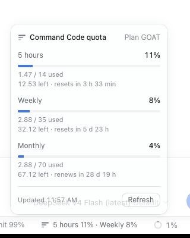

# dsh-provider-commandcode

**DeepSeek Harness**（`dsh`）的 Command Code（[commandcode.ai](https://commandcode.ai)）provider 插件。

一个路由（`commandcode`），两条 Provider API 线：**Claude 走 Anthropic Messages**，**其余模型走 Chat Completions**。按真实套餐过滤的实时模型表、零配置复用 `command-code` CLI 的登录、**输入框下方的额度状态栏**、reasoning effort、工具调用、图片、缓存 token 统计，以及 `/commandcode` 诊断命令。



非官方社区插件，与 Command Code / DeepSeek 无从属关系。

## 前置条件

- `dsh` 0.2.x（`engines.dsh: >=0.2.0 <0.3.0`）。
- 具备 **Provider API** 权限的 Command Code 账号（Pro、GOAT、Max、Ultra、Team、Provider）。**Go** 套餐没有 Provider API，请求会返回 `403 upgrade_required`。

## 安装

```sh
# npm（发布后）
dsh plugin --profile web add dsh-provider-commandcode

# 本地 checkout
dsh plugin --profile web add /path/to/dsh-provider-commandcode

# git（pnpm 会先要求允许该包的构建脚本）
dsh plugin --profile web add github:abcdlsj/dsh-provider-commandcode
```

随后 `dsh web`（或 `dsh tui`、`dsh headless "任务"`）。插件行为 `llm-commandcode`，可在 profile 的 `cordis.patch.yml` 里覆盖其 `config`。

## 认证

每个请求解析 API key，取第一个命中：

1. **credentials 服务**中 `apiKeyEnv`（默认 `COMMANDCODE_API_KEY`）的值 —— web Models 页写入的就是它。
2. 启动环境里的 `$COMMANDCODE_API_KEY`（或配置的 `apiKeyEnv` 名）。
3. `$COMMAND_CODE_API_KEY`。
4. 依次尝试 auth 文件：配置的 `authFile`、`$COMMANDCODE_AUTH_FILE`、`~/.commandcode/auth.json`（`command-code` CLI 自己的登录）、`$PI_CODING_AGENT_DIR/auth.json` 或 `~/.pi/agent/auth.json`、`~/.omp/agent/auth.json`。

所以已经在用 `command-code` CLI 的用户无需任何配置。headless profile 会禁用 credentials 服务，这正是 CLI 登录兜底存在的原因。

不可用的值（空白，或 HTTP header 无法承载的字符）会以 `INVALID_CREDENTIAL` 报出需要修改的设置项，绝不回显 key。

**跨来源回退。** provider 对当前 key 返回 `401` 时，插件弃用它并尝试下一个来源（`keyFallback: false` 可关闭）。因此过期的 `command-code` CLI 登录会让位给仍然有效的 `~/.pi/agent/auth.json` 凭据，而不是让请求失败。最多尝试 5 个不同 key，绝不重复，并记录一条标明两个来源的告警。

## 选择模型

在模型选择器里选 `Command Code`，或在 profile overlay 中固定：

```yaml
- id: agent-default-model
  config:
    provider: commandcode
    model: claude-opus-5
```

套餐内的所有模型都可服务：Claude 走 `/messages`，其他走 `/chat/completions`（即使该模型同时声明了 `/responses`）。工具调用、流式 reasoning、图片、usage（含缓存与 reasoning token）、stop 序列和 `max_tokens` 均已映射。

### 按套餐过滤

插件读取订阅（`/alpha/billing/subscriptions`）与官方 CLI catalog 的 `Min plan` 列，只列出当前档位可调用的模型：

| `plan` | 效果 |
| --- | --- |
| `auto`（默认） | 读取账号套餐；有充值或赠送额度时所有模型都可见。 |
| `go` / `goat` / `pro` / `max` | 固定档位，不读账号。 |
| `all` | 全部列出，交给 Command Code 拒绝。 |

高于档位的模型在**发请求之前**就被拒绝，并说明所需档位与当前档位。账号读取失败时**放行**：所有模型照常列出，并在 `/commandcode status` 里给出告警——绝不会变成空列表。

### 额度状态栏

当前会话选中 `commandcode` 模型时，输入框下方出现额度胶囊：`5 小时 11% · 本周 8%`。点开显示套餐、各滚动窗口的已用/上限与重置倒计时、本月额度，以及手动刷新。每 60 秒与页面重新可见时刷新，切到其他 provider 自动隐藏。浏览器不接触 API key：宿主读取 `/alpha/billing/credits`，响应客户端的 `commandcode/usage` 调用。

## 配置

全部字段可选，默认值无需配置即可工作。

| 字段 | 默认 | 含义 |
| --- | --- | --- |
| `apiKeyEnv` | `COMMANDCODE_API_KEY` | 凭据引用，同时是环境变量名。 |
| `keyFallback` | `true` | 遇到 `401` 时弃用该 key，尝试下一个来源。 |
| `plan` | `auto` | `auto` 读取账号套餐；固定档位则过滤；`all` 全列出。 |
| `referenceCatalog` | `true` | 从官方 CLI catalog 刷新 reasoning efforts 与套餐门槛。 |
| `referenceMaxAgeMs` | `21600000` | 一次刷新后的有效期。 |
| `quota` | `true` | 暴露额度读取，供状态栏与 `/commandcode quota` 使用。 |
| `authFile` | — | 显式 command-code `auth.json` 路径，优先于默认文件。 |
| `baseURL` | `https://api.commandcode.ai/provider/v1` | Provider API 根地址。 |
| `modelsURL` | `<baseURL>/models` | 模型列表端点。 |
| `discovery` | `true` | 拉取实时模型表；`false` 只用内置快照。 |
| `modelsMaxAgeMs` | `300000` | 列表新鲜期。 |
| `modelsTimeoutMs` | `10000` | 单次发现请求超时。 |
| `models` | `[]` | 声明模型或覆盖单个模型（见下）。 |
| `cliVersion` | `1.88.3` | `x-command-code-version` 头，需对应已发布 CLI。 |
| `projectSlug` | `cwd` 末段 | `x-project-slug` 头。 |
| `sessionId` | 每进程一个 UUID | `x-session-id` 头。 |
| `zdr` | `false` | 发送 `x-cmd-zdr: 1`，只走零数据保留上游（通常更贵）。 |
| `thinking` | `effort` | Messages 线 thinking 方式：`effort`（`output_config.effort`）、`budget`（`budget_tokens`）、`disabled`。 |
| `reasoningBack` | `auto` | Chat 线回放历史 reasoning：`auto`（仅当模型要求）、`always`、`never`。 |
| `maxTokens` | `64000` | 默认输出上限；请求显式值优先。 |
| `maxRequestImageBytes` | `5242880` | 单请求解码后图片字节预算。 |
| `maxImagesPerRequest` | `10` | 单请求图片数量上限。 |
| `streamIdleTimeoutMs` | `180000` | 流读取空闲超时。 |
| `retryPolicy` | dsh 默认（`RATE_LIMIT`、`SERVER` 等） | 模型请求重试策略；`{ mode: always }` 全部重试。 |

单模型覆盖可补充列表未含的模型，或修正能力：

```yaml
- id: llm-commandcode
  name: dsh-provider-commandcode
  config:
    models:
      - id: acme/next-model
        name: Acme Next
        wire: chat            # 或 messages
        contextWindow: 400000
        maxTokens: 64000
        inputModalities: [text, image]
        efforts: [low, high, max]
```

## 斜杠命令

挂载了命令注册表时可用 `/commandcode`：

- `/commandcode status` —— 端点、模型表与 CLI catalog 来源、套餐、凭据来源（绝不显示 key）、thinking 与回放策略。
- `/commandcode models [过滤词]` —— 当前套餐内的模型，以及被套餐排除的数量。
- `/commandcode quota` —— 套餐、滚动窗口、本月额度、重置倒计时。
- `/commandcode plan` —— 档位如何解析，以及各档位分别解锁多少模型。
- `/commandcode refresh` —— 强制刷新模型表、CLI catalog 与套餐，再报告来源与告警。

## 行为说明

- **降级只学一次。** 模型拒绝 `reasoning_effort`（Chat 线）或 `thinking`/`output_config`（Messages 线）时，插件去掉该字段重试同一请求，记一条告警，此后该模型不再发送；要求回传 `reasoning_content` 的模型同理。
- **Messages 线不回放 thinking。** 本适配器不保存签名，回放无签名 thinking 会被 Anthropic 拒绝，因此历史 thinking 一律不发送。
- **模型发现不会拖垮请求。** 刷新失败保留上一次好列表，再退到内置快照；告警在 `/commandcode status` 中可见。套餐解析失败同样放行。
- **账号读取与推理共用同一套凭据回退**，因此过期的 CLI 登录不会成为读不到套餐或额度的原因。
- **错误码稳定。** `401` → `INVALID_CREDENTIAL`；`403 upgrade_required` → `INVALID_CREDENTIAL` 且说明套餐原因；`403 MODEL_NOT_IN_PLAN` → `PLAN_REQUIRED`；`402`/配额 → `QUOTA`；`429` → `RATE_LIMIT`（带 `retry-after`）；上下文超限 → `CONTEXT_WINDOW_EXCEEDED`；Google 模型的 JSON 指针会被内联。
- **图片走 harness attachment 服务**，每个请求只重新编码一次；超出预算时报 `IMAGE_OFFLOAD_REQUIRED`，不静默丢弃。
- **状态栏是客户端插件**（`client.js`，经 `dsh.client` 加载），注册到 `conversation.composer.dock`；没有浏览器界面时它什么也不做。
- **每个请求都带 harness 归因头**（`user-agent: deepseek-harness/…`），外加 CLI 自己的 `x-command-code-version`、`x-cli-environment`、`x-project-slug`、`x-taste-learning`、`x-session-id`。

## 设计边界

- **只用 Provider API。** 插件绝不调用 CLI 的 `/alpha/generate`：那是官方客户端的接口，不是文档化的 API，用它等于绕过 Provider API 权限。`403 upgrade_required` 如实上报，不做规避。
- **只实现 Chat Completions 与 Messages。** 同时声明 `/responses` 的模型走 `/chat/completions`（它们全都支持）；Responses 线路未实现。
- **没有 Files API，也不回放 thinking 签名。** 图片内联发送；历史 thinking 在 Messages 线上一律不发。
- **单一路由。** `commandcode` 固定；网关或镜像通过 `baseURL`/`modelsURL` 接入，而不是新增路由。

## 排错

| 现象 | 原因与处理 |
| --- | --- |
| `INVALID_CREDENTIAL: Invalid 'Authorization' header or token` | key 过期或错误。重新运行 `command-code` 登录，或设置 `COMMANDCODE_API_KEY`。 |
| `403 upgrade_required` | 套餐无 Provider API（Go）。升级套餐，或改用官方 CLI。 |
| `PLAN_REQUIRED: MODEL_NOT_IN_PLAN` | 该模型不在你的套餐内。换模型或购买额外用量。 |
| `MISSING_CREDENTIAL` | 任何来源都没有 key。设置 `COMMANDCODE_API_KEY` 或用 CLI 登录。 |
| `422 cmd_zdr_no_providers` | 开了 `zdr: true` 但没有零保留上游服务该模型。关掉 ZDR 或换模型。 |
| 模型列表陈旧或为空 | `/commandcode refresh`；检查 `modelsURL` 与代理。`discovery: false` 固定使用内置快照。 |

## 开发

```sh
npm install --ignore-scripts   # 首次安装否则会执行 prepare 构建
npm run typecheck
npm test
npm run build
```

模块划分：`config.ts`（schema 与连接）、`catalog.ts`（发现、兜底、覆盖、套餐过滤）、`reference.ts`（官方 CLI catalog 与刷新）、`account.ts`（套餐与额度读取）、`plan.ts`（档位解析）、`quota.ts`（状态栏读数）、`remote.ts`（`commandcode/usage` 端点）、`credentials.ts`、`adapter.ts`（传输、请求头、降级）、`chat.ts`/`messages.ts`（线路序列化与 SSE 翻译）、`sse.ts`、`errors.ts`、`images.ts`、`google-schema.ts`、`static-catalog.ts`、`static-reference.ts`。

`client.js` 手写为客户端模块系统的 lazy-CJS 工厂格式（不经过打包器）；`node --check client.js` 与 `npm test` 覆盖它。

### 已实测

- 真实端点 `GET /provider/v1/models` 发现：95 个模型，11 个 Claude 走 Messages，84 个走 Chat Completions，84 个支持图片。
- GOAT 套餐下经由 Chat Completions 的完整 `dsh headless` 工具调用回路（`deepseek/deepseek-v4-flash`，effort `high`）：reasoning 增量、`bash` 工具调用、工具结果与最终回答。
- 真实 Web 客户端：boot 图正确下发 `dsh-provider-commandcode/client.js`，选中 `commandcode` 会话后额度胶囊出现，面板显示真实 GOAT 窗口、本月额度与重置倒计时，启动过程零异常、零 console error。
- 真实账号上的套餐过滤：GOAT 下 `gpt-6-sol`（PRO）与 `claude-opus-5`（MAX）在发出任何 HTTP 请求前被本地拒绝，GOAT 模型正常工作。
- 跨来源凭据回退：过期的 `~/.commandcode/auth.json` 在一次 `401` 后让位给仍然有效的 `~/.pi/agent/auth.json`，提示不失败。
- Messages 线路由协议级测试覆盖。GOAT 套餐的 Provider API 权限不含 Claude（`403 MODEL_NOT_IN_PLAN` 由 Command Code 返回），真实 Claude 请求需要 Provider 及以上套餐的 key。

## 致谢

- 模型能力表（输入模态、reasoning efforts、最大输出）来自 `command-code` CLI manifest，经由 [pi-commandcode-provider](https://github.com/patlux/pi-commandcode-provider)（MIT）整理。
- `google-schema.ts` 改编自 magpie-community [plugins](https://github.com/magpie-community/plugins) 的 Command Code 包（MIT）。

## 许可

MIT。
